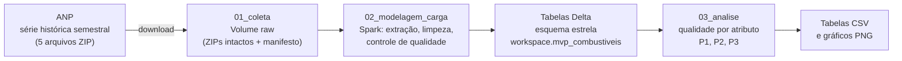
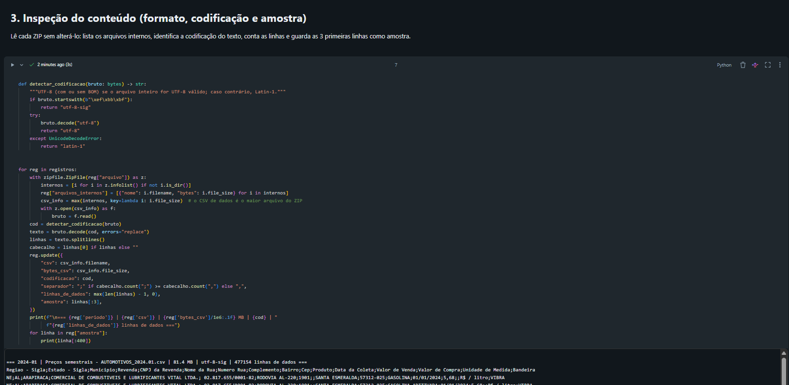
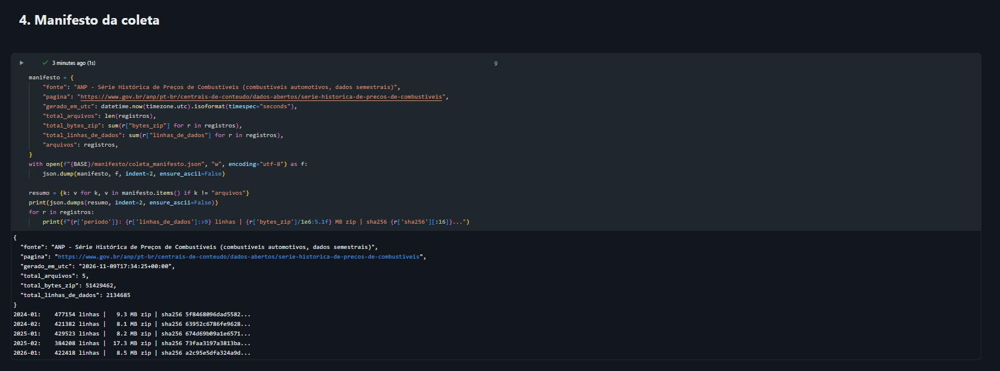
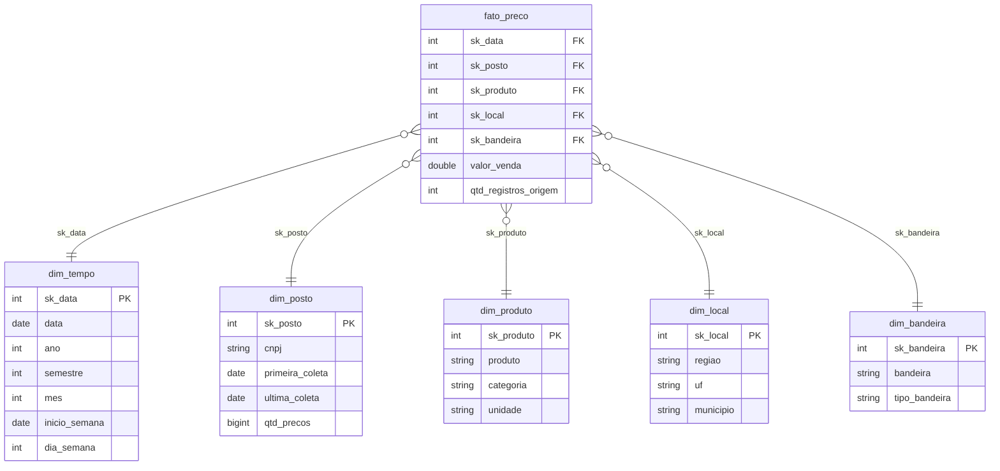
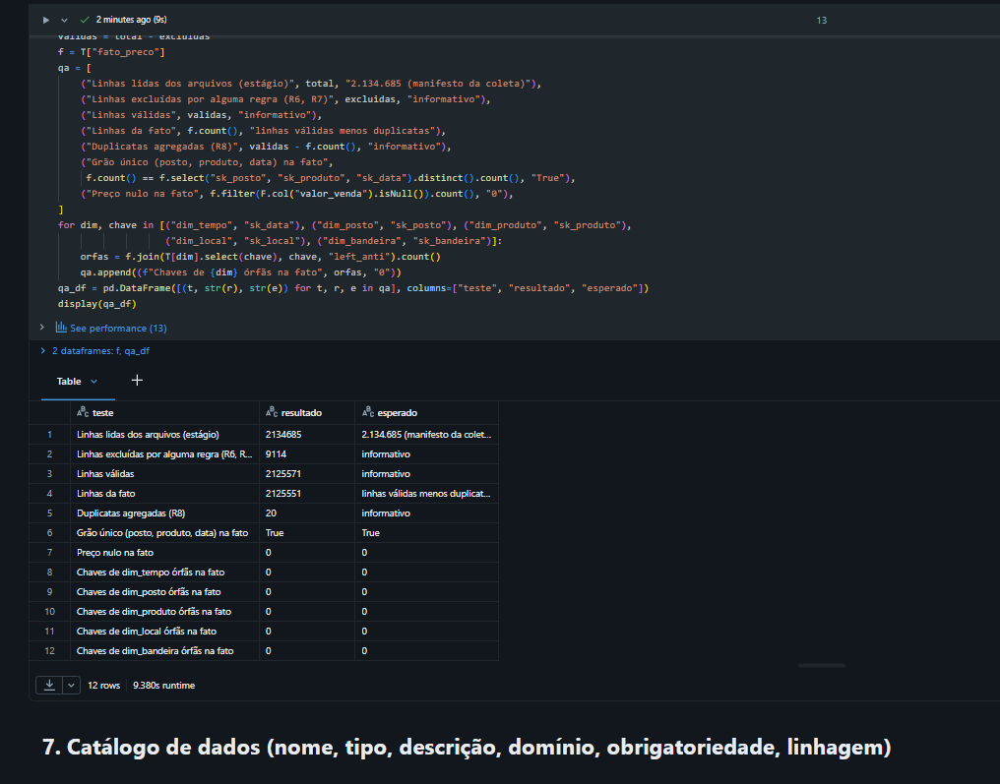
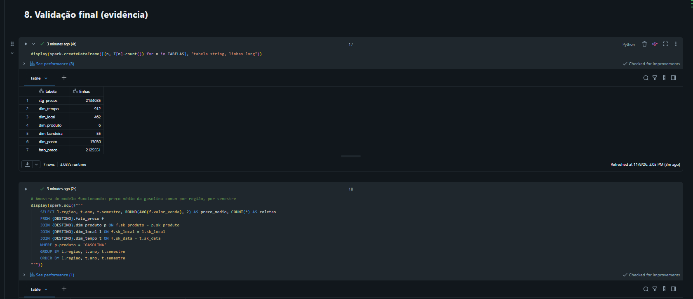
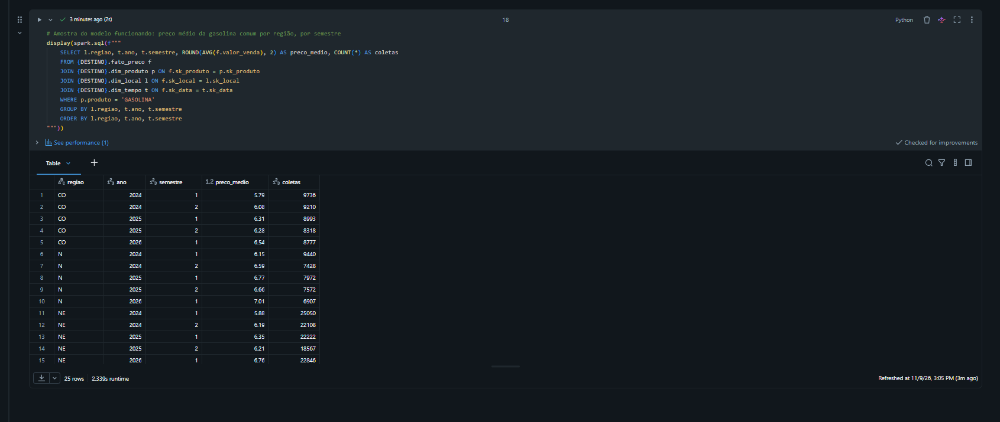
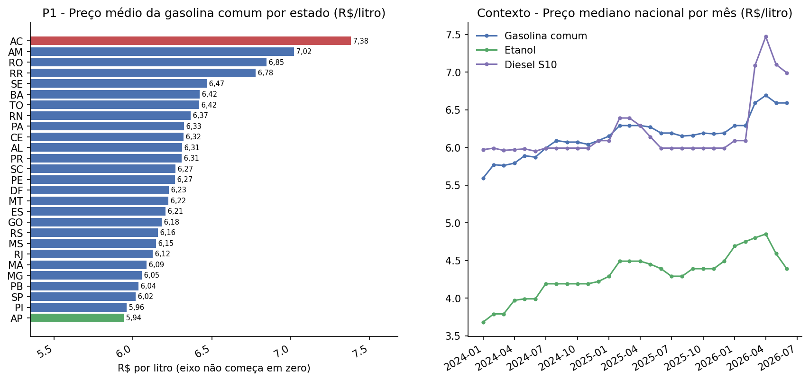
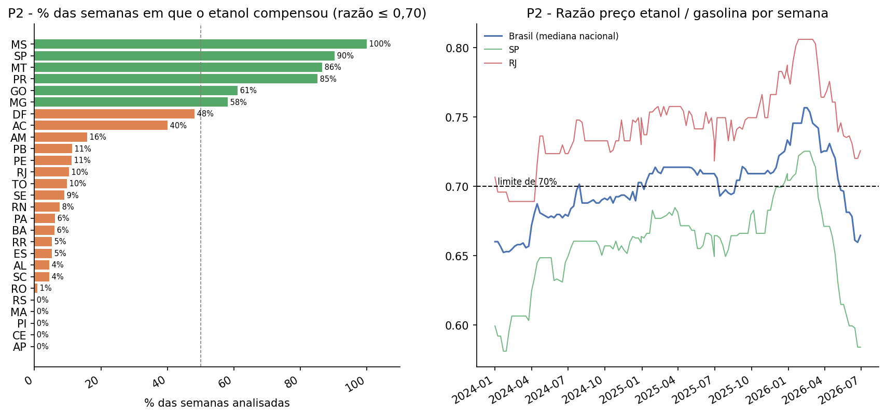
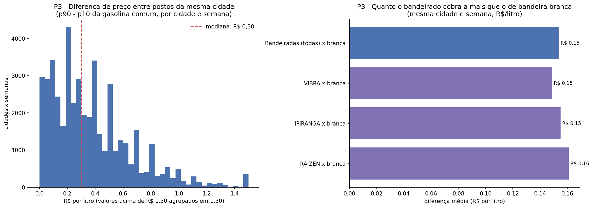

# Onde e com o que abastecer? Um Sistema de Apoio à Decisão com os preços de combustíveis da ANP

**MVP (Minimum Viable Product): pipeline de dados em nuvem**

| | |
|---|---|
| **Instituição** | Universidade de Brasília (UnB), Departamento de Engenharia de Produção |
| **Disciplina** | PSP8 |
| **Professor** | André Luiz Marques Serrano |
| **Autor** | João Pedro Ferreira Bitencourt (matrícula 211068047) |
| **Plataforma** | Databricks Free Edition: Unity Catalog, Delta Lake, Spark, computação serverless |

| Seção | Conteúdo |
|---|---|
| [1. Objetivo](#1-objetivo) | Problema, hipótese, perguntas de negócio e viabilidade |
| [2. Arquitetura e reprodução](#2-arquitetura-do-pipeline-e-reprodução) | Visão geral do pipeline e passo a passo para rodar |
| [3. Busca e coleta](#3-busca-e-coleta) | Fonte, licença, data, volume e formato |
| [4. Modelagem](#4-modelagem) | Esquema estrela, catálogo de dados e regras de transformação |
| [5. Carga](#5-carga-etl) | Pipeline de ETL em Spark e validações |
| [6. Análise](#6-análise) | Qualidade dos dados, respostas às perguntas e discussão |
| [7. Autoavaliação](#7-autoavaliação) | Objetivos atingidos, limitações e próximos passos |
| [8. Ética e licenças](#8-ética-licenças-e-proteção-de-dados) | Licença, LGPD e uso dos dados |

---

## 1. Objetivo

### 1.1 Problema

O combustível é um dos maiores custos variáveis de quem roda de carro e, sobretudo, de empresas com frota (entregas, vendas externas, serviços de campo). Mesmo assim, a decisão de **onde abastecer e com qual combustível** costuma ser tomada no olho. A ANP (Agência Nacional do Petróleo, Gás Natural e Biocombustíveis) pesquisa toda semana o preço cobrado em milhares de postos do país. Este MVP organiza mais de 2 milhões desses preços para medir **quanto essa decisão realmente pesa no bolso**.

**Decisão apoiada:** a política de abastecimento de uma frota, ou seja, com que combustível rodar, onde abastecer e se vale a pena exigir pesquisa de preço. Em termos de Engenharia de Produção, trata-se de reduzir o custo operacional de um insumo de alto consumo a partir de dados.

### 1.2 Hipótese

> Onde e com o que se abastece faz diferença relevante no custo: o preço varia muito entre estados, o etanol só compensa em parte do país e, mesmo dentro de uma cidade, a diferença entre postos justifica pesquisar preço.

**Como a hipótese é verificada:** pela diferença de preço entre estados em reais por tanque (P1), pela proporção de semanas em que o etanol fica abaixo de 70% do preço da gasolina (P2), e pela dispersão de preços dentro da mesma cidade e semana, inclusive entre postos com e sem marca de distribuidora (P3).

### 1.3 Perguntas de negócio

| # | Pergunta | Decisão que informa |
|---|---|---|
| **P1** | Quanto o preço da gasolina varia entre os estados, e quanto isso representa num tanque de 50 litros? | Onde concentrar o abastecimento de rotas interestaduais |
| **P2** | Em quais estados, e em que proporção das semanas, o etanol compensa mais que a gasolina (preço do etanol até 70% do da gasolina)? Isso mudou ao longo do tempo? | Com que combustível abastecer veículos flex, por estado |
| **P3** | Quanto o preço varia entre postos de uma mesma cidade? Postos de bandeira branca (sem marca de distribuidora) são mais baratos que os de bandeira? | Se vale exigir pesquisa de preço e se postos de bandeira branca devem entrar na política |

As perguntas foram definidas antes da coleta. Os dados foram escolhidos depois, por serem a fonte oficial e aberta capaz de respondê-las.

### 1.4 Viabilidade

| Dimensão | Evidência neste MVP |
|---|---|
| **Técnica** | Pipeline completo (coleta, modelagem, carga e análise) executado no Databricks, com dados persistidos em Volume e tabelas Delta do Unity Catalog e transformação distribuída em Spark ([seção 5](#5-carga-etl)) |
| **Financeira** | Custo de infraestrutura zero: Databricks Free Edition e dados públicos e gratuitos. Uma execução completa leva cerca de 10 minutos: 1 a 3 minutos de coleta, cerca de 5 de ETL e 2 a 4 de análise |
| **Desejabilidade** | As três perguntas foram respondidas e geram regras práticas de abastecimento, com economia estimada em reais por tanque ([seção 6.5](#65-discussão-geral)) |

---

## 2. Arquitetura do pipeline e reprodução

### 2.1 Estrutura do repositório

| Caminho | Conteúdo |
|---|---|
| `README.md` | Este documento |
| `notebooks/01_coleta.py` | Download dos 5 arquivos semestrais, gravação no Volume e manifesto da coleta |
| `notebooks/02_modelagem_carga.py` | ETL em Spark: extração, regras de transformação, esquema estrela, controle de qualidade, carga e catálogo |
| `notebooks/03_analise.py` | Qualidade dos dados por atributo e respostas às perguntas |
| `catalogo/` | Catálogo de dados (`.md` e `.csv`) |
| `evidencias/` | Capturas de tela da execução e gráficos dos resultados |
| `LICENSE` | Licença do código e registro da licença dos dados |

Os notebooks estão no formato *source* do Databricks (`.py` com marcadores `# COMMAND ----------`) e podem ser importados diretamente no Workspace.

### 2.2 Como reproduzir

1. Crie uma conta no [Databricks Free Edition](https://www.databricks.com/learn/free-edition).
2. Em **Workspace**, use **Import** para trazer os três arquivos da pasta `notebooks/`.
3. Rode `01_coleta` com **Run all**. O notebook cria o schema `workspace.mvp_combustiveis` e o Volume `raw` e baixa os 5 arquivos, o que leva de 1 a 3 minutos.
4. Rode `02_modelagem_carga`, que leva cerca de 5 minutos e grava as 7 tabelas.
5. Rode `03_analise`, que leva de 2 a 4 minutos e salva tabelas e gráficos em `/Volumes/workspace/mvp_combustiveis/raw/resultados`.

Para outro período, basta alterar a lista `PERIODOS` no notebook 01.

---

## 3. Busca e coleta

### 3.1 Fonte de dados

| Item | Descrição |
|---|---|
| **Conjunto** | [Série Histórica de Preços de Combustíveis e de GLP](https://www.gov.br/anp/pt-br/centrais-de-conteudo/dados-abertos/serie-historica-de-precos-de-combustiveis), da ANP |
| **Recorte** | Combustíveis automotivos (gasolina comum e aditivada, etanol hidratado, diesel S-500 e S-10 e GNV), arquivos semestrais |
| **Origem do dado** | Levantamento de preços semanal, feito por empresa contratada pela ANP, com o preço de venda ao consumidor praticado em cada posto pesquisado |
| **Período** | 1º semestre de 2024 a 1º semestre de 2026 (01/01/2024 a 30/06/2026) |
| **Colunas originais** | Região, estado, município, nome do posto, CNPJ, endereço (rua, número, complemento, bairro e CEP), produto, data da coleta, valor de venda, valor de compra, unidade de medida e bandeira ([metadados](https://www.gov.br/anp/pt-br/centrais-de-conteudo/dados-abertos/arquivos/shpc/metadados-serie-historica-precos-combustiveis-1.pdf)) |

### 3.2 Coleta

A coleta é feita pelo notebook [`01_coleta`](notebooks/01_coleta.py), que roda inteiramente no Databricks. Antes, foi verificado que a computação serverless da Free Edition alcança o servidor da ANP ([evidência 1](evidencias/01_teste_acesso_anp.png)).

| Item | Valor |
|---|---|
| Data da coleta | 09/11/2026 (manifesto gerado às 17:34 UTC) |
| Arquivos | 5 ZIPs (`ca-2024-01` a `ca-2026-01`), 51.429.462 bytes no total |
| Conteúdo | 1 CSV por ZIP, de 63,7 a 81,4 MB cada (cerca de 361 MB descompactados) |
| Formato original | CSV, separador `;`, vírgula decimal, datas `dd/mm/aaaa`, codificação UTF-8 com BOM |
| Volume | **2.134.685 linhas de dados** (477.154 / 421.382 / 429.523 / 384.208 / 422.418 por semestre) |
| Integridade | SHA-256 de cada ZIP registrado no manifesto `coleta_manifesto.json` |
| Local na nuvem | `/Volumes/workspace/mvp_combustiveis/raw/anp/` |

**Decisões da coleta:**
- **Dados intactos.** Os ZIPs são gravados exatamente como publicados. A descompactação só acontece no ETL, que lê os arquivos sem alterá-los.
- **Robustez.** O download tem até 5 tentativas, verifica a assinatura do arquivo ZIP e grava primeiro em arquivo temporário, para que uma interrupção não deixe arquivo corrompido. Uma nova execução reaproveita o que já foi baixado.
- **Inspeção automática.** O notebook identifica a codificação, conta as linhas e guarda as 3 primeiras linhas de cada CSV no manifesto. Foi essa amostra que revelou, antes da modelagem, que o **CNPJ vem em formatos diferentes** conforme o semestre (` 02.817.655/0001-82` e `04431113000100`) e que a coluna **Valor de Compra vem vazia** ([evidência 2](evidencias/02_coleta_formato_arquivos.png)).

| | |
|---|---|
| Amostra do formato de cada arquivo |  |
| Manifesto da coleta: 5 arquivos, 2.134.685 linhas |  |

---

## 4. Modelagem

### 4.1 Esquema estrela

| Tabela | Papel | Grão | Linhas |
|---|---|---|---|
| `fato_preco` | Fato | Um preço de um produto, em um posto, em uma data de coleta | 2.125.551 |
| `dim_tempo` | Dimensão | Um dia (01/01/2024 a 30/06/2026) | 912 |
| `dim_local` | Dimensão | Um município (UF + nome) | 462 |
| `dim_posto` | Dimensão | Um posto (CNPJ) | 13.030 |
| `dim_produto` | Dimensão | Um combustível | 6 |
| `dim_bandeira` | Dimensão | Uma bandeira (distribuidora ou branca) | 55 |
| `stg_precos` | Estágio | Uma linha dos arquivos, com o motivo de exclusão quando houver | 2.134.685 |

**Por que esse desenho:**
- **A bandeira fica na fato, e não no posto.** Um posto pode trocar de distribuidora ao longo do tempo. Gravar a bandeira vigente na data de cada coleta evita atribuir a um preço antigo a bandeira atual do posto.
- **`inicio_semana` na dimensão de tempo.** As perguntas P2 e P3 comparam preços na mesma semana. Ter a segunda-feira de cada semana pronta na dimensão evita recalcular a semana em cada consulta.
- **Município identificado por UF + nome.** Há municípios homônimos em estados diferentes, por isso há 462 linhas na dimensão contra 461 nomes distintos.

### 4.2 Catálogo de dados

O catálogo completo, com **42 atributos em 7 tabelas**, está em [`catalogo/catalogo_dados.md`](catalogo/catalogo_dados.md) e [`catalogo/catalogo_dados.csv`](catalogo/catalogo_dados.csv). Para cada atributo, ele registra **nome, tipo, descrição, domínio, obrigatoriedade e linhagem**. O notebook 02 confere por código que o catálogo contém exatamente as colunas e os tipos das tabelas gravadas. Resumo da fato:

| Atributo | Tipo | Domínio | Obrigatório | Linhagem |
|---|---|---|---|---|
| `sk_data` | numérico (chave) | AAAAMMDD, FK `dim_tempo` | Sim | ANP `Data da Coleta` (R5, R12) |
| `sk_posto` | numérico (chave) | FK `dim_posto` | Sim | ANP `CNPJ da Revenda` (R3) |
| `sk_produto` | numérico (chave) | FK `dim_produto` | Sim | ANP `Produto` (R9) |
| `sk_local` | numérico (chave) | FK `dim_local` | Sim | ANP `Estado - Sigla`, `Municipio` |
| `sk_bandeira` | numérico (chave) | FK `dim_bandeira` | Sim | ANP `Bandeira` (R10) |
| `valor_venda` | numérico | R$ 2 a 15 por litro; R$ 1 a 15 por m³ | Sim | ANP `Valor de Venda` (R4, R6, R8) |
| `qtd_registros_origem` | numérico | Inteiro, 1 ou mais | Sim | Duplicatas agregadas (R8) |

### 4.3 Regras de transformação

| # | Regra | Motivo |
|---|---|---|
| R1 | As 16 colunas são lidas por posição, como texto, com separador `;` e UTF-8. Os nomes originais (com acentos e espaços) são substituídos por nomes padronizados | O cabeçalho tem acentos, espaços e BOM. Ler tudo como texto evita conversões automáticas erradas |
| R2 | Espaços nas pontas removidos e caixa alta em UF, município, produto e bandeira | Padroniza as chaves de agrupamento |
| R3 | CNPJ com só os dígitos. Válido se tiver 14 dígitos | O arquivo traz o CNPJ com e sem pontuação, conforme o semestre |
| R4 | Vírgula decimal convertida em ponto e o preço vira número | Formato numérico brasileiro |
| R5 | Data convertida de `dd/MM/aaaa` para `DATE` | Padronização |
| R6 | Preços fora de R$ 2 a R$ 15 por litro (R$ 1 a R$ 15 por m³ no GNV) são marcados e excluídos | Barreira contra erros grosseiros de digitação |
| R7 | Linhas com CNPJ inválido, UF ou município ausente, data inválida, preço ausente, preço fora da faixa ou produto desconhecido ficam no estágio, com o motivo registrado, e não entram na fato | Nada é descartado sem rastro |
| R8 | Mais de um preço para o mesmo posto, produto e data vira uma linha com o preço médio. A quantidade original fica registrada | Garante o grão da fato |
| R9 | GASOLINA e GASOLINA ADITIVADA = Gasolina; DIESEL e DIESEL S10 = Diesel; ETANOL = Etanol; GNV = GNV | Agrupamento por categoria |
| R10 | `BRANCA` = Bandeira branca; demais = Bandeirada | Necessário para a P3 |
| R11 | Nome do posto e endereço não entram no modelo, e o posto é identificado só pelo CNPJ. A coluna Valor de Compra é descartada por vir vazia | Minimização de dados (LGPD) e ausência de conteúdo |
| R12 | `sk_data` = AAAAMMDD. As demais chaves substitutas são sequenciais | Padronização de chaves |
| R13 | Tabelas sobrescritas a cada execução | Idempotência |

---

## 5. Carga (ETL)

O notebook [`02_modelagem_carga`](notebooks/02_modelagem_carga.py) faz o ETL **inteiramente em Spark**, de forma distribuída. Os CSVs são lidos diretamente pelo leitor de arquivos do Spark, as regras são aplicadas como expressões de coluna e as dimensões e a fato são montadas por agregações e junções. As 7 tabelas são gravadas em formato **Delta** no Unity Catalog (`workspace.mvp_combustiveis`).

**Controle de qualidade depois da carga** ([evidência 4](evidencias/04_qualidade_etl.png)):

| Verificação | Resultado | Esperado |
|---|---|---|
| Linhas lidas dos arquivos | 2.134.685 | 2.134.685 (manifesto da coleta) |
| Linhas excluídas por alguma regra | 9.114 (0,43%) | informativo |
| Linhas válidas | 2.125.571 | informativo |
| Duplicatas agregadas (R8) | 20 | informativo |
| Linhas da fato | 2.125.551 | válidas menos duplicatas |
| Grão único (posto, produto, data) | Sim | Sim |
| Preço nulo na fato | 0 | 0 |
| Chaves órfãs (tempo, posto, produto, local, bandeira) | 0 em todas | 0 |

| | |
|---|---|
| Controle de qualidade do ETL |  |
| Contagem das 7 tabelas Delta gravadas |  |
| Consulta de exemplo no modelo: preço médio da gasolina por região e semestre |  |

---

## 6. Análise

A análise é feita pelo notebook [`03_analise`](notebooks/03_analise.py). As agregações pesadas rodam em Spark, e só os resultados, que são tabelas pequenas, vão para o pandas, para exibição e gráficos.

### 6.1 Qualidade dos dados

**Perfil por atributo** da tabela de estágio (2.134.685 linhas):

| Atributo | Nulos | Distintos | Mínimo | Máximo | Observação |
|---|---:|---:|---|---|---|
| `arquivo_origem` | 0 | 5 | | | Um valor por semestre |
| `regiao` | 9.114 (0,43%) | 5 | | | Todas as regiões |
| `uf` | 9.114 (0,43%) | 27 | | | Todas as UFs |
| `municipio` | 9.114 (0,43%) | 461 | | | |
| `cnpj` | 9.114 (0,43%) | 13.030 | | | Postos distintos |
| `produto` | 9.114 (0,43%) | 6 | | | |
| `unidade` | 9.114 (0,43%) | 3 | | | Duas grafias para m³ (ver abaixo) |
| `bandeira` | 9.114 (0,43%) | 55 | | | |
| `data_coleta` | 9.114 (0,43%) | 680 | 01/01/2024 | 30/06/2026 | Período completo |
| `valor_venda` | 9.114 (0,43%) | 656 | R$ 2,63 | R$ 9,99 | |

Os 9.114 nulos são as **mesmas linhas em todos os atributos**: linhas em branco nos arquivos, sem CNPJ, local, produto, data nem preço. Elas foram barradas pela primeira regra de exclusão (CNPJ inválido), e são esse o único motivo de exclusão observado.

**Avaliação por dimensão de qualidade:**

| Dimensão | Verificação | Resultado | Tratamento |
|---|---|---|---|
| **Completude** | Nulos por atributo; semanas sem coleta | 0,43% de linhas em branco. Nenhuma semana do período sem coleta. A coluna Valor de Compra vem 100% vazia | Linhas em branco excluídas (R7). Valor de Compra descartada (R11) |
| **Unicidade** | Grão (posto, produto, data) | 20 duplicatas em 2,1 milhões de linhas | Agregadas pela média (R8) |
| **Consistência** | UF x região oficial; produto x unidade | 0 UFs com região errada. 0 produtos com unidade incoerente | Nenhum necessário |
| **Conformidade** | Formatos e domínios | O CNPJ vem em dois formatos conforme o semestre. A unidade do GNV aparece como "R$ / m³" (36.888 linhas) e "R$ / m3" (8.732), que são a mesma unidade com outra grafia ([evidência 7](evidencias/07_verificacao_unidade_extremos.png)) | CNPJ padronizado (R3). Grafias tratadas como equivalentes na análise |
| **Acurácia** | Preços implausíveis | Apenas 714 preços (0,03%) passam de R$ 9. Na gasolina comum, 1.908 preços (0,34%) estão mais de 25% acima ou abaixo da mediana da própria cidade na semana, entre R$ 4,55 e R$ 9,79 | Faixa plausível (R6) e, na P3, medidas por percentis (p10 e p90), que não se deixam levar por valores isolados |
| **Atualidade** | Período coberto | Dados até 30/06/2026, último semestre publicado na data da coleta | Período documentado |

**Conclusão:** a base é grande, regular e consistente. Os problemas encontrados são pontuais e foram tratados por regras explícitas. O cuidado principal está nos preços isolados muito distantes da mediana local: eles distorcem medidas de mínimo e máximo, por isso a P3 usa percentis.

### 6.2 P1: Quanto o preço da gasolina varia entre os estados?

**Resposta:** a gasolina comum mais cara está no **Acre (R$ 7,39/L)** e a mais barata no **Amapá (R$ 5,94/L)**, na média de jan/2024 a jun/2026. A diferença é de **R$ 1,44 por litro, ou R$ 72 por tanque de 50 litros (24%)**. A diferença entre estados é **estrutural**: o ranking quase não muda ao longo do tempo, com correlação de 0,90 entre os rankings do primeiro e do último semestre.

| Estado | Preço médio (R$/L) | Custo do tanque (R$) | A mais por tanque vs. estado mais barato (R$) | Postos |
|---|---:|---:|---:|---:|
| AC (mais cara) | 7,39 | 369,25 | 72,20 | 40 |
| AM | 7,02 | 351,05 | 54,00 | 156 |
| RO | 6,85 | 342,35 | 45,30 | 144 |
| RR | 6,78 | 338,85 | 41,80 | 34 |
| ... | | | | |
| MG | 6,06 | 302,75 | 5,70 | 1.295 |
| PB | 6,04 | 301,80 | 4,75 | 169 |
| SP | 6,02 | 300,80 | 3,75 | 3.728 |
| PI | 5,96 | 297,95 | 0,90 | 184 |
| AP (mais barata) | 5,94 | 297,05 | 0,00 | 52 |

| Região | Preço médio (R$/L) |
|---|---:|
| Norte | 6,61 |
| Nordeste | 6,27 |
| Sul | 6,24 |
| Centro-Oeste | 6,19 |
| Sudeste | 6,05 |

A tabela completa dos 27 estados está em `p1_gasolina_por_uf.csv`, gerado pelo notebook.

**Discussão:**
- **O Norte concentra os extremos.** Os 4 estados mais caros são do Norte (AC, AM, RO e RR), mas o mais barato do país (AP) também é. A localização pesa, mas não explica tudo sozinha: diferenças de tributação estadual e de logística de abastecimento, que não estão nesta base, são hipóteses para estudos futuros.
- **A diferença é estável.** Como o ranking quase não muda (correlação 0,90), uma frota que roda entre estados pode planejar onde abastecer com base em médias históricas, sem precisar monitorar o preço toda semana.
- **Contexto de mercado:** a mediana nacional da gasolina comum subiu de R$ 5,59 (jan/2024) para cerca de R$ 6,60 (jun/2026). O 2º semestre de 2025 teve uma queda temporária na maioria dos estados. O diesel S10 teve alta forte no 1º semestre de 2026.

### 6.3 P2: Quando o etanol compensa?

**Resposta:** o etanol compensou (custou até 70% do preço da gasolina) na maioria das semanas em **apenas 6 dos 27 estados**: **MS (100% das semanas), SP (90%), MT (87%), PR (85%), GO (61%) e MG (58%)**. Em 5 estados ele **nunca** compensou no período (RS, MA, PI, CE e AP). A vantagem **encolheu muito** no período: eram 10 estados com etanol vantajoso na maioria das semanas no 1º semestre de 2024, contra 4 em 2025 e no 1º semestre de 2026.

| Estado | % das semanas com etanol vantajoso | Razão etanol/gasolina mediana |
|---|---:|---:|
| MS | 100,0% | 0,649 |
| SP | 90,3% | 0,662 |
| MT | 86,5% | 0,643 |
| PR | 85,1% | 0,684 |
| GO | 61,2% | 0,684 |
| MG | 58,2% | 0,699 |
| DF | 48,1% | 0,708 |
| AC | 40,0% | 0,703 |
| AM | 15,8% | 0,735 |
| RJ | 10,4% | 0,743 |
| ... (demais estados abaixo de 12%) | | |
| RS, MA, PI, CE | 0,0% | 0,761 a 0,790 |

**Evolução:** número de estados com etanol vantajoso na maioria das semanas, por semestre.

| Semestre | 2024-S1 | 2024-S2 | 2025-S1 | 2025-S2 | 2026-S1 |
|---|---:|---:|---:|---:|---:|
| Estados | 10 | 8 | 4 | 5 | 4 |

| Estado | 2024-S1 | 2024-S2 | 2025-S1 | 2025-S2 | 2026-S1 |
|---|---:|---:|---:|---:|---:|
| SP | 100% | 100% | 100% | 93% | 59% |
| PR | 100% | 96% | 93% | 85% | 52% |
| GO | 100% | 100% | 41% | 37% | 30% |
| MG | 100% | 100% | 15% | 52% | 26% |
| DF | 100% | 96% | 15% | 4% | 28% |
| RJ | 54% | 0% | 0% | 0% | 0% |
| MS | 100% | 100% | 100% | 100% | 100% |

**Discussão:**
- **O etanol é uma vantagem regional.** Os estados onde ele compensa são produtores de cana ou vizinhos deles (Centro-Oeste, SP, PR e MG). No Norte, no Nordeste e no Sul (exceto PR), a gasolina foi a escolha certa em quase todas as semanas.
- **A regra precisa ser revista com frequência.** A razão nacional ficou abaixo de 0,70 em quase todo o ano de 2024, oscilou em torno ou acima de 0,70 em 2025, chegou a cerca de 0,76 no início de 2026 e voltou para baixo de 0,70 em maio e junho de 2026. Em estados como GO, MG e DF, a melhor escolha mudou de semestre para semestre. Uma política fixa ("sempre etanol" ou "sempre gasolina") erraria parte do tempo.
- **Ressalvas:** (1) a regra dos 70% é uma aproximação do rendimento médio do etanol em relação à gasolina, e a paridade real depende do veículo; (2) no Amapá só houve 3 semanas com coletas suficientes de etanol (mínimo de 5 por semana), e em Roraima 76, então esses resultados são menos confiáveis.

### 6.4 P3: Quanto o preço varia entre postos da mesma cidade? A bandeira importa?

**Resposta:** na mediana das **46.212 combinações de cidade e semana** analisadas (459 cidades com pelo menos 5 postos), a diferença entre os 10% de postos mais caros e os 10% mais baratos é de **R$ 0,30 por litro**. Abastecer entre os 10% mais baratos, em vez de pagar o preço mediano da cidade, economiza **R$ 6,00 por tanque**. Postos de **bandeira branca são mais baratos em 73% das comparações**, em média **R$ 0,15 por litro (R$ 7,69 por tanque)**. A diferença é estatisticamente significativa (teste de Wilcoxon pareado, p < 0,001).

| Indicador (gasolina comum, por cidade e semana) | Valor |
|---|---:|
| Combinações cidade x semana analisadas | 46.212 (459 cidades) |
| Diferença p90 - p10, mediana | **R$ 0,30/L** |
| Diferença p90 - p10, 3º quartil | R$ 0,51/L |
| % das combinações com diferença p90 - p10 de R$ 0,30 ou mais | 50,6% |
| Economia mediana por tanque (preço mediano para p10) | **R$ 6,00** |
| Coeficiente de variação mediano | 2,02% |
| *Diferença máximo - mínimo, mediana (sensível a extremos)* | *R$ 0,38/L* |
| *Economia mediana por tanque contra o posto mais barato (teto)* | *R$ 7,50* |

**Maiores cidades** (por número médio de postos pesquisados por semana):

| Cidade | Postos por semana | Diferença p90 - p10 (R$/L) | Economia por tanque (R$) |
|---|---:|---:|---:|
| São Paulo (SP) | 203 | 0,92 | 17,50 |
| Rio de Janeiro (RJ) | 80 | 0,60 | 13,50 |
| Brasília (DF) | 49 | 0,22 | 6,00 |
| Curitiba (PR) | 47 | 0,14 | 6,50 |
| Fortaleza (CE) | 45 | 0,22 | 1,75 |
| Goiânia (GO) | 41 | 0,20 | 7,50 |
| Belo Horizonte (MG) | 39 | 0,50 | 7,00 |
| Manaus (AM) | 38 | 0,00 | 0,00 |
| Porto Alegre (RS) | 36 | 0,40 | 10,00 |
| Recife (PE) | 27 | 0,06 | 1,00 |
| Campinas (SP) | 24 | 0,62 | 17,00 |

**Bandeira branca x postos bandeirados** (mesma cidade e semana, pelo menos 2 postos de cada grupo):

| Comparação | Pares cidade x semana | Diferença média (R$/L) | Diferença mediana (R$/L) | Branca mais barata | Diferença por tanque (R$) |
|---|---:|---:|---:|---:|---:|
| Bandeiradas (todas) x branca | 37.476 | 0,154 | 0,10 | 73,4% | 7,69 |
| Vibra x branca | 20.371 | 0,149 | 0,08 | 71,1% | 7,45 |
| Ipiranga x branca | 20.794 | 0,155 | 0,10 | 74,0% | 7,77 |
| Raízen x branca | 14.941 | 0,161 | 0,10 | 75,9% | 8,04 |

**Discussão:**
- **Pesquisar preço vale mais nas cidades grandes e competitivas.** Em São Paulo, Rio e Campinas, a economia mediana passa de R$ 13 por tanque. Em Manaus e Recife, os preços são praticamente iguais entre postos. Para uma frota, isso indica que a exigência de pesquisa de preço deve ser **por cidade**, e não uma regra única.
- **A bandeira branca é sistematicamente mais barata.** A comparação foi feita dentro da mesma cidade e semana, para não confundir o efeito da bandeira com o da localização. A diferença é praticamente a mesma para as três maiores distribuidoras (R$ 0,15 a R$ 0,16 por litro), o que sugere um prêmio de marca, e não um efeito específico de uma empresa.
- **Por que percentis:** o mínimo e o máximo de uma cidade são sensíveis a um único preço digitado errado. Em São Paulo, a diferença entre o posto mais caro e o mais barato chega a R$ 3,20 por litro na mediana das semanas, enquanto a diferença p90 - p10 é de R$ 0,92. Os resultados principais usam percentis, e o mínimo e o máximo aparecem só como referência.
- **Ressalvas:** a análise mede **preço**, e não qualidade do combustível ou serviço. A economia estimada não desconta o custo de deslocamento até o posto mais barato.

### 6.5 Discussão geral

**A hipótese foi confirmada.** As três decisões (onde, com o que e em qual posto abastecer) mudam o custo de forma relevante:

| Decisão | Efeito medido |
|---|---|
| Em qual estado abastecer (rotas interestaduais) | Até R$ 72 por tanque entre o estado mais caro e o mais barato |
| Etanol ou gasolina | O etanol compensa na maioria das semanas em só 6 estados, e a vantagem muda de semestre para semestre |
| Pesquisar preço na cidade | R$ 6,00 por tanque na mediana, e mais de R$ 13 em São Paulo, Rio e Campinas |
| Bandeira branca | R$ 7,69 por tanque a menos, em média, na mesma cidade e semana |

**Exemplo ilustrativo para uma frota.** Supondo um abastecimento de 50 litros por semana por veículo, as duas práticas locais (pesquisar preço e aceitar bandeira branca) valem algo da ordem de **R$ 300 a R$ 400 por veículo por ano** cada uma (R$ 6,00 a R$ 7,69 × 52 semanas). As duas economias não devem ser somadas, porque parte dos postos mais baratos já é de bandeira branca. Numa frota de 50 veículos, isso significa **entre R$ 15 mil e R$ 20 mil por ano** com mudanças de política, sem investimento.

**Política de abastecimento sugerida:**
1. **Combustível por estado, revisado mensalmente:** etanol em MS, SP, MT e PR; nos demais estados, a decisão depende da razão do mês, com gasolina como padrão no Norte, no Nordeste, no RS e em SC.
2. **Pesquisa de preço obrigatória nas cidades de alta dispersão** (como São Paulo, Rio e Campinas) e dispensável nas de preço uniforme (como Manaus e Recife).
3. **Incluir postos de bandeira branca** na lista de postos credenciados da frota.

---

## 7. Autoavaliação

**1. Quais perguntas foram respondidas e quais não foram? Por quê?**
As três perguntas foram respondidas com dados, evidências e discussão. A P1 e a P3 foram respondidas por completo, com a ressalva de que a P3 compara preços e não qualidade. A P2 foi respondida para 26 dos 27 estados com confiança. No Amapá só houve 3 semanas com dados suficientes de etanol, o que torna o resultado desse estado pouco confiável.

**2. Que limitações dos dados condicionaram os resultados?**
- **A pesquisa da ANP é amostral:** não cobre todos os postos do país toda semana, e as médias refletem os postos pesquisados.
- **Não há dados de impostos e custos de logística,** que explicariam as diferenças entre estados (P1).
- **A coluna Valor de Compra vem vazia,** o que impediu analisar a margem dos postos.
- **A regra dos 70% é uma aproximação:** a paridade real entre etanol e gasolina depende do consumo de cada veículo.
- **Preços isolados implausíveis** (0,34% na gasolina) exigiram medidas robustas na P3.

**3. O que faria diferente se recomeçasse?**
- **Criar uma regra específica para linhas em branco.** As 9.114 linhas vazias foram barradas corretamente, mas pela regra de CNPJ inválido, porque era a primeira a ser testada. Um motivo "linha vazia" deixaria o registro de qualidade mais claro.
- **Padronizar a grafia da unidade** ("m3" e "m³") já no ETL, e não só na análise.
- **Executar o pipeline como Job do Databricks,** em vez de notebooks interativos. Na importação dos notebooks também apareceu uma falha da interface do Databricks ao renomear arquivos com nome repetido, contornada importando os arquivos já com o nome final.
- **Comparação com o MVP anterior (SSD):** a autoavaliação daquele trabalho apontou que o ETL em pandas não escalava. Aqui o ETL foi escrito inteiramente em Spark, o que permitiu processar 2,1 milhões de linhas sem esforço.

**4. Que extensões transformariam o MVP em solução de uso contínuo?**
- **Carga semanal automática,** usando a série mensal que a ANP também publica, agendada como Job, para manter a recomendação de combustível sempre atualizada.
- **Paridade por veículo:** cruzar com dados de consumo de cada modelo (por exemplo, o Programa Brasileiro de Etiquetagem Veicular) para calcular quando o etanol compensa para cada carro da frota.
- **Painel** com mapa de preços por cidade e a recomendação semanal de combustível por estado.
- **Roteirização:** combinar preços por posto com as rotas da frota, para indicar onde abastecer em cada trajeto, descontando o deslocamento.

---

## 8. Ética, licenças e proteção de dados

| Tema | Situação |
|---|---|
| **Licença dos dados** | Dados publicados pela ANP como **dados abertos** no portal gov.br, no âmbito da Política de Dados Abertos do Poder Executivo Federal ([Decreto nº 8.777/2016](https://www.planalto.gov.br/ccivil_03/_ato2015-2018/2016/decreto/d8777.htm)). O decreto define dados abertos como dados disponibilizados sob licença aberta que permite sua livre utilização, consumo ou cruzamento, limitando-se a creditar a autoria ou a fonte. A fonte (ANP) é creditada neste README e nos notebooks. Na data da coleta, a página do conjunto no Portal Brasileiro de Dados Abertos estava indisponível (erro HTTP 401), o que impediu registrar o nome exato da licença |
| **Redistribuição** | Por cautela, **os dados brutos não são versionados neste repositório.** O repositório contém apenas o código, que baixa os dados diretamente da ANP. Os dados persistem na nuvem (Databricks) |
| **Dados pessoais (LGPD, Lei nº 13.709/2018)** | Os arquivos identificam postos de combustível, que são pessoas jurídicas, por nome, CNPJ e endereço. Mesmo assim, aplicou-se o princípio da minimização: **nome e endereço dos postos não entram no modelo** (R11), e o posto é identificado apenas pelo CNPJ, necessário para distinguir os estabelecimentos. As análises são feitas de forma agregada, por estado, cidade e bandeira |
| **Dados corporativos** | Não foram usados dados de nenhuma empresa |
| **Código** | Licença MIT ([LICENSE](LICENSE)) |

---

## Referências

- ANP. *Série Histórica de Preços de Combustíveis e de GLP*. https://www.gov.br/anp/pt-br/centrais-de-conteudo/dados-abertos/serie-historica-de-precos-de-combustiveis
- ANP. *Metadados da Série Histórica de Preços de Combustíveis*. https://www.gov.br/anp/pt-br/centrais-de-conteudo/dados-abertos/arquivos/shpc/metadados-serie-historica-precos-combustiveis-1.pdf
- BRASIL. *Decreto nº 8.777, de 11 de maio de 2016* (Política de Dados Abertos do Poder Executivo Federal).
- BRASIL. *Lei nº 13.709, de 14 de agosto de 2018* (Lei Geral de Proteção de Dados Pessoais).
- Databricks. *Databricks Free Edition limitations*. https://docs.databricks.com/aws/en/getting-started/free-edition-limitations
